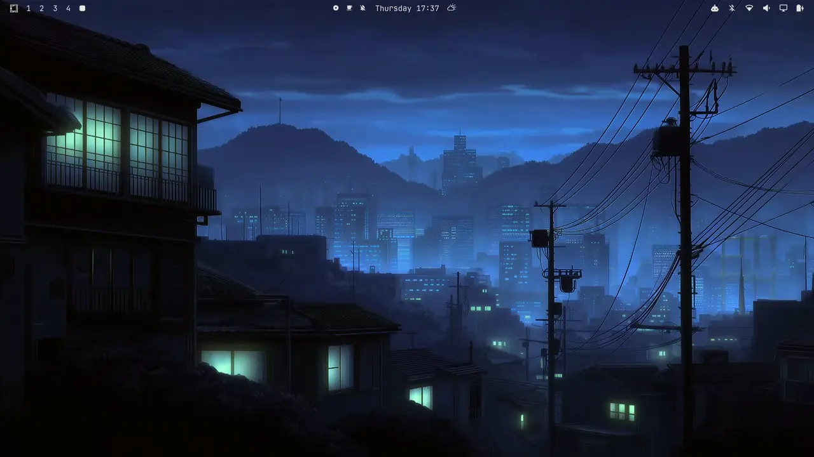
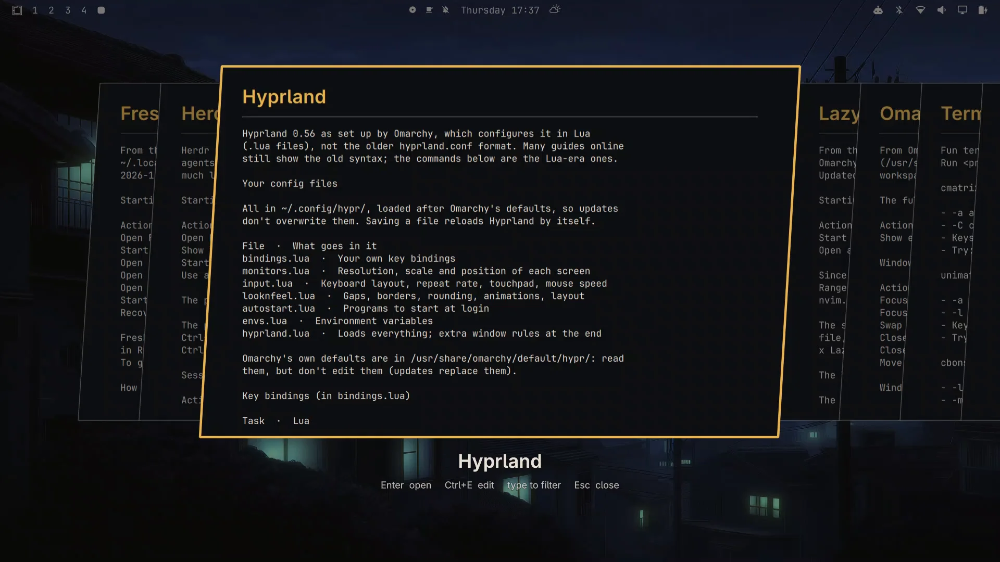
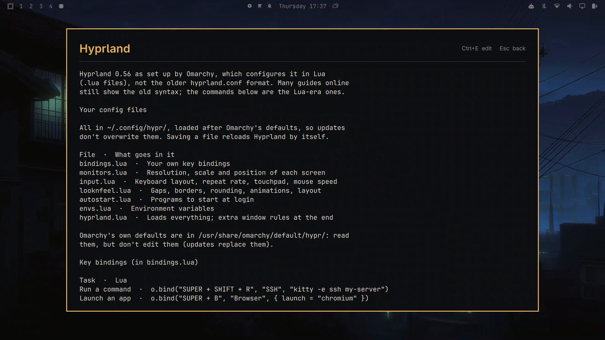

# Omarchy Quick Reference

Your cheat sheets, one key away, on top of whatever you're doing. For
[Omarchy](https://omarchy.org).



You're in the middle of something: writing a document, editing code, filling
in a form. You need one small fact. The key that splits a window, the
command you always forget, the setting on that printer. Normally that means
leaving your work: switching to a file manager, finding the folder, opening
the file, scrolling to the right spot, then finding your way back again.

With Quick Reference you press one key. Your documents appear as large cards
over your screen. Glance at the card, or press `Enter` to read the whole
document. Then press `Esc`, and you're back exactly where you were, with
your cursor still in place. A few seconds, and you never left your work.

## Why it helps

- **It stays out of the way.** It opens over your current window and closes
  with `Esc`. No new windows to tidy up, no workspace switching.
- **The answer is often on the card.** Each card shows the start of the
  document, so a quick look is frequently enough.
- **No hunting.** Your documents are always in one place, behind one key,
  instead of somewhere in a folder tree or a pile of browser tabs.
- **Typing finds things.** Start typing a name and the cards narrow down to
  the one you want.
- **It fits in.** It looks and works like Omarchy's own pickers and follows
  your theme's colours.

## What to put in it

It is meant for a short list you pick yourself, the documents you keep
coming back to, not everything on your disk:

- cheat sheets and keyboard shortcuts
- recipes
- specs for the hardware you work with
- runbooks, procedures and checklists
- study notes

## How it works

1. Put the documents you want at hand in one folder:
   `~/Documents/Quick Reference` (created the first time you open the
   plugin; you can choose another folder, see [Settings](#settings)).
2. Press your key (see [Install](#install)).
3. Your documents appear as cards in a carousel, like Omarchy's background
   switcher, in your theme's colours. Text and Markdown cards show the
   title and the start of the document; images and PDFs show the picture
   or first page.
4. Scroll with the arrow keys, or type to filter by title.
5. Press `Enter` to read the one you need.

When you no longer need a document, move it out of the folder. That's all
the managing there is.





## Keys

On the cards:

| Key | Action |
|---|---|
| `Left` / `Right` (or `Tab` / `Shift+Tab`) | Previous / next card |
| Type letters | Filter by title (`Backspace` edits, `Esc` clears) |
| `Enter` or click | Open the selected document |
| `Ctrl+E` | Edit a text or Markdown document in your default editor |
| `Esc` | Close |

Reading a text or Markdown document:

| Key | Action |
|---|---|
| `Up` / `Down` (or `k` / `j`) | Scroll |
| `Page Up` / `Page Down`, `Space` | Scroll a page |
| `Home` / `End` | Top / bottom |
| `e` or `Ctrl+E` | Edit it in your default editor |
| `Esc` | Back to the cards |
| `q` | Close |

## Supported files

| File | Card shows | Opens in |
|---|---|---|
| Markdown (`.md`), text (`.txt`) | Title and the start of the text | A read-only plain-text view in the panel (Markdown symbols are left out) |
| Images (`.png`, `.jpg`, `.webp`, `.gif`) | The image | Your default image viewer |
| PDF (`.pdf`) | The first page | Your default PDF viewer |

PDF previews use `pdftoppm`, which comes with Omarchy, so there is nothing
extra to install. Editing uses Omarchy's default editor, the one you chose
in the Omarchy menu.

**Word and LibreOffice documents** (`.docx`, `.odt` and so on) are not
supported: previewing them would need a full office suite running in the
background. Save them as PDF instead; every office app can, and the PDF
looks the same. Files the plugin can't show are skipped, so nothing breaks
if one ends up in the folder.

## Requirements

- Omarchy with its shell running. Built and tested on Omarchy 4.0.6.

## Install

```bash
omarchy plugin add https://github.com/ggregoro/Omarchy-Quick-Reference.git --enable
omarchy restart shell
```

Then give it a key. Add this line to `~/.config/hypr/bindings.lua`
(`Super+Shift+K` is free on a stock Omarchy):

```lua
o.bind("SUPER + SHIFT + K", "Quick Reference", "omarchy-shell shell toggle ggregoro.quick-reference")
```

Hyprland picks up the change as soon as you save. You can also open it
from a terminal with the command inside the quotes.

## Settings

To use another folder, add a `folder` field to the plugin's entry in the
`plugins` list of `~/.config/omarchy/shell.json`:

```json
{ "id": "ggregoro.quick-reference", "folder": "~/Recipes" }
```

`~` means your home folder. Without a `folder` field, the plugin uses
`~/Documents/Quick Reference`.

Tip: links work. To keep a document where it is and still show it here,
link it into the folder (`ln -s ~/notes/tmux.md ~/Documents/"Quick Reference"/`).

## Examples

The [`examples`](examples) folder has three sample documents to try it with:
a recipe, a hardware spec sheet and a set of keyboard shortcuts. Copy them
into your folder to see how cards look.

## Maybe later

- Searching inside documents

## Credits

The carousel is Omarchy's own image picker (MIT, see
[`LICENSE-OMARCHY`](LICENSE-OMARCHY)), with document cards in place of
wallpaper thumbnails. It started as a small script that turned a folder of
cheat sheets into preview images for that picker, and worked well enough
to deserve a proper plugin.

## License

GPL-3.0, see [`LICENSE`](LICENSE).
